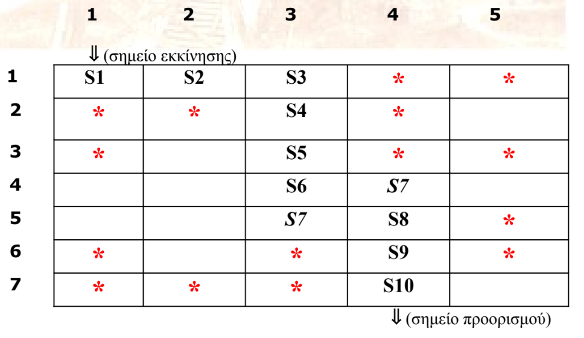

Τη νύχτα της 25ης προς 26η Νοεμβρίου του 1942 οι ενωμένες αντιστασιακές δυνάμεις του ΕΛΑΣ υπό τον Άρη Βελουχιώτη και του ΕΔΕΣ υπό τον Ναπολέοντα Ζέρβα πραγματοποίησαν το μεγαλύτερο ίσως σαμποτάζ στην κατεχόμενη Ευρώπη: Διέκοψαν τη γραμμή εφοδιασμού της Βέρμαχτ, ανατινάζοντας τη γέφυρα του Γοργοποτάμου στη Φθιώτιδα. 60 αντάρτες του ΕΛΑΣ ανέλαβαν το νότιο άκρο, 40 αντάρτες του ΕΔΕΣ το βόρειο, 12 Άγγλοι σαμπτοτέρ υπονόμευσαν τη γέφυρα και ο καπετάν Νικηφόρος του ΕΛΑΣ με 30 άνδρες έμειναν κρυμμένοι - εφεδρεία προκειμένου να επέμβουν εφόσον χρειάζονταν. Ο καπετάν Νικηφόρος εξέφρασε τη δυσαρέσκειά του που έμεινε σε εφεδρεία, αλλά υπήρξε ο καθοριστικός παράγων της επιτυχίας. Μόλις δόθηκε το σήμα ο καπετάν Νικηφόρος κινήθηκε ανάμεσα από ναρκοπέδια και τα πεδία βολής των πολυβολείων, αναγνωρισμένα από πριν, για να φθάσει στο βόρειο άκρο που υπήρξε πρόβλημα. Ο καπετάν Νικηφόρος και οι αντάρτες του έπρεπε να κινηθούν, επιλέγοντας τη συντομότερη διαδρομή, μόνο εμπρός ή δεξιά ή αριστερά, με μικρά βήματα και χωρίς να βγουν έξω από το πεδίο της μάχης, προκειμένου να κατορθώσουν να φθάσουν έγκαιρα στο επιθυμητό σημείο. Ήταν σαν κινούνταν σε μία τεράστια σκακέρια γεμάτη νάρκες!

## Πρόβλημα

Να αναπτύξετε ένα πρόγραμμα σε μια από τις γλώσσες του ΙΟΙ το οποίο: 
 1. Θα διαβάζει από ένα αρχείο τις διαστάσεις του ορθογώνιου πεδίου μάχης, τον αριθμό και τη θέση (συντεταγμένες) των ναρκών, το σημείο εκκίνησης και το σημείο προορισμού. 
 2. Θα υπολογίζει τη συντομότερη διαδρομή από το σημείο εκκίνησης έως το σημείο προορισμού, η οποία σε καμία περίπτωση δεν πρέπει να ξεπερνά τις διαστάσεις του ορθογωνίου ή να περνά πάνω από νάρκη. Η διαδρομή πρέπει να περιλαμβάνει μόνο επιτρεπτές κινήσεις (κάτω, δεξιά, αριστερά). 
 3. Θα δίνει σαν έξοδο ένα αρχείο που θα έχει τον αριθμό των κινήσεων και τις συντεταγμένες τους. Αν δεν υπάρχει τέτοια διαδρομή θα τυπώνει τον αριθμό 0.

Μια κίνηση προς τα κάτω ισοδυναμεί με αύξηση του $$Y$$, μια κίνηση προς τα δεξιά με αύξηση του $$Χ$$ ενώ μια κίνηση προς τα αριστερά με μείωση του $$X$$.

## Αρχεία εισόδου

Τα αρχεία εισόδου με όνομα **sabotage.in** είναι αρχεία κειμένου με την εξής δομή: Στην πρώτη γραμμή έχουν δύο αριθμούς (χωριζόμενους από ένα κενό) $$X$$, $$Y$$ ($$1 < X, Y \leq 1.000$$) τις διαστάσεις του πεδίου της μάχης. Στη δεύτερη γραμμή υπάρχει ένας αριθμός $$N$$ ($$1 \leq N \leq 1.000.000$$), που δίνει το αριθμό των ναρκών ή των σημείων ορατότητας των πολυβολείων. Οι επόμενες $$N$$ γραμμές έχουν τις συντεταγμένες των παραπάνω, με τη μορφή $$X_i$$, $$Y_i$$ (χωριζόμενες με ένα κενό). Η προτελευταία γραμμή έχει τις συντεταγμένες του σημείου εκκίνησης και η τελευταία τις συντεταγμένες του σημείου προορισμού (χωριζόμενες με ένα κενό).

## Αρχεία εξόδου

Τα αρχεία εξόδου με όνομα sabotage.out είναι αρχεία κειμένου με την εξής δομή: Στη πρώτη γραμμή υπάρχει ο αριθμός των κινήσεων $$M$$ ($$0 < M < 1.000.000$$). Οι επόμενες $$M$$ γραμμές έχουν τις συντεταγμένες των κινήσεων, με τη μορφή $$X_i$$, $$Y_i$$ (χωριζόμενες με ένα κενό). Εάν δεν υπάρχει δυνατή διαδρομή μόνο το $$0$$.

**Παρατηρήσεις:**
 1. Το πεδίο είναι 'ορθογώνιο' (διαστάσεων $$X$$, $$Y$$).
 2. Το σημείο εισόδου θα είναι πάντα πάνω $$(Χ_{\text{εισόδου}}, 1)$$ ενώ το σημείο εξόδου πάντα κάτω $$(X_\text{εξόδου}, Y)$$.
 3. Οι επιτρεπτές κινήσεις είναι Κάτω ($$+Y$$), Δεξιά ($$+X$$) ή Αριστερά ($$-X$$).
 4. Μπορεί να υπάρχουν περισσότερες από μία σωστές διαδρομές. Αυτές βαθμολογούνται ισοδύναμα μεταξύ τους.
 5. Μπορεί να βρεθούν διαδρομές με περισσότερες κινήσεις που όμως να οδηγούν στον προορισμό χωρίς διέλευση από απαγορευμένο σημείο. Και οι λύσεις αυτές θα βαθμολογηθούν με τουλάχιστον 60% και αντιστρόφως ανάλογα του αριθμού των επιπλέον κινήσεων.
 6. Ούτε στην εκκίνηση ούτε στον προορισμό υπάρχει νάρκη.
 7. Οι θέσεις των όλων των ναρκών είναι γνωστές εκ των προτέρων.

## Παραδείγματα αρχείων εισόδου - εξόδου

**1o (δύο ισοδύναμα αρχεία εξόδου)**

| **sabotage.in**                         | **sabotage.out** | **sabotage.out** |
| ------------------------------------ | ------------- | ------------- |
| 5 7 15 4 1 5 1 1 2 2 2 4 2 1 3 4 3 5 3 5 5 1 6 3 6 5 6 1 7 2 7 3 7 1 1 4 7 | 10 1 1 2 1 3 1 3 2 3 3 3 4 4 4 4 5 4 6 4 7|10 1 1 2 1 3 1 3 2 3 3 3 4 3 5 4 5 4 6 4 7|
{:.table_with_monospace_font}

**2o**

| **sabotage.in**                         | **sabotage.out** |
| ------------------------------------ | ------------- |
| 5 7 5 1 2 2 2 3 2 4 2 5 2 4 1 2 7 | 0|
{:.table_with_monospace_font}

## Περιορισμοί
 - **Χρόνος εκτέλεσης:** 10 δευτερόλεπτα.
 - **Μέγιστη απαίτηση μνήμης:** 32 MB.

