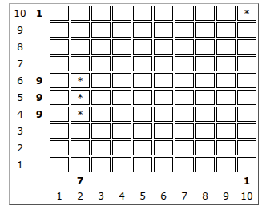
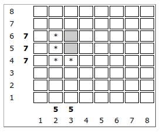

Οι Ελληνικές Ένοπλες Δυνάμεις με στόχο την προστασία των νησιών του ανατολικού Αιγαίου, ανέπτυξαν από τη δεκαετία του 70 συστήματα επιτήρησης ακτογραμμών με χρήση sonar. Ειδικά σε περιοχές στρατηγικής σημασίας, το δίκτυο sonar αναπτύχθηκε σε καρτεσιανή μορφή για μεγαλύτερη αποτελεσματικότητα. Το Σώμα Πληροφορικής, σε συνεργασία με το τμήμα Πληροφορικής και Τηλεπικοινωνιών του Πανεπιστημίου Αθηνών, ανέλαβε να αναπτύξει κατάλληλο λογισμικό, ώστε να υπάρχει ψηφιακή απεικόνιση του κάθε επιτηρούμενου πεδίου. Στο παρακάτω σχήμα φαίνεται ένα τέτοιο παράδειγμα:

Με έντονα μαύρα γράμματα εμφανίζεται η στάθμη του σήματος που λαμβάνεται κατά τη λήψη του εκπεμφθέντος ηχοσυρμού. Είναι φανερό ότι:

1. Το σήμα είναι τόσο μικρότερης στάθμης όσο μακρύτερα εντοπιστεί στόχος. (Για σύστημα $$N \times N$$ sonar ο εγγύτερος στο sonar στόχος έχει σήμα στάθμης $$N$$ και ο πλέον απομεμακρυσμένος 1).
2. Όταν οι στόχοι κινούνται σε σειρά ή σε μέτωπο το αντίστοιχο sonar λαμβάνει μόνο σήμα από τον εγγύτερο στόχο. (Στο σχήμα μας, το δεύτερο οριζόντιο sonar λαμβάνει μόνο το σήμα από τον στόχο με συντεταγμένες $$[2, 4]$$).

**Παρατήρηση:** Στόχοι που είναι καλυμμένοι και κατά μέτωπο και κατά σειρά, δηλαδή εσωτερικοί σε νηοπομπή στόχοι, **ΔΕΝ** μπορούν να εντοπιστούν. (Σκοτεινή περιοχή στο παρακάτω σχήμα)

## Πρόβλημα

Να αναπτύξετε ένα πρόγραμμα σε μια από τις γλώσσες του ΙΟΙ το οποίο: Αφού διαβάζει τις μη μηδενικές στάθμες σήματος που λαμβάνει κάθε sonar (πρώτα οριζόντιων και μετά κάθετων), θα επιστρέφει το πλήθος των στόχων που μπορούν να εντοπιστούν και ταξινομημένες με βάση τις τεταγμένες τους (οριζόντιος άξονας), τις θέσεις των στόχων. Στο παράδειγμά μας: [2, 4], [2, 5], [2, 6], [10, 10]. Σημειώνεται ότι στόχοι που μπορούν να εντοπιστούν και από τα οριζόντια και από τα κάθετα sonar (πχ. [2, 4] & [10, 10]) «κλειδώνονται» και καταγράφονται <u>μόνο μια φορά</u>.

## Αρχεία εισόδου

Τα αρχεία εισόδου με όνομα **sonar.in** είναι αρχεία κειμένου με την εξής δομή: Στην πρώτη γραμμή έχουν έναν αριθμό $$N$$ ($$10 \leq N \leq 99.999$$) τις διαστάσεις ($$N \times N$$) του επιτηρούμενου πεδίου. Στη δεύτερη γραμμή έχουν δύο αριθμούς $$M_1$$, $$M_2$$ (χωριζόμενους με ένα κενό) τον αριθμό των οριζόντιων και κάθετων sonar που ανίχνευσαν στόχο ($$M_1, M_2 \leq N^2$$). Στις επόμενες $$Μ_1$$ γραμμές υπάρχουν με αύξουσα σειρά οι αριθμοί και η αντίστοιχη στάθμη σήματος, των οριζόντιων sonar που εντόπισαν στόχο. Στις επόμενες $$Μ_2$$ γραμμές υπάρχουν με αύξουσα σειρά οι αριθμοί και η αντίστοιχη στάθμη σήματος, των κάθετων sonar που εντόπισαν στόχο. Σε όλα τα sonar ο αριθμός τους από τη στάθμη σήματος, χωρίζονται με ένα κενό.

## Αρχεία εξόδου

Τα αρχεία εξόδου με όνομα sonar.out είναι αρχεία κειμένου με την εξής δομή. Στην πρώτη γραμμή υπάρχει ένας ακέραιος αριθμός Ν που εκφράζει τον αριθμό των στόχων που εντοπίστηκαν. Ακολουθούν N γραμμές σε κάθε μία από τις οποίες υπάρχουν οι συντεταγμένες των στόχων που εντοπίστηκαν, ταξινομημένες με βάση τις τεταγμένες τους. Στο παράδειγμά μας [2, 4], [2, 5], [2, 6], [10, 10]

## Παραδείγματα αρχείων εισόδου - εξόδου

**1o**

| **sonar.in**                         | **sonar.out** |
| ------------------------------------ | ------------- |
| 10 2 4 2 7 10 1 4 9 5 9 6 9 10 1 | 4 2 4 2 5 2 6 10 10|
{:.table_with_monospace_font}

## Περιορισμοί
 - **Μορφοποίηση:** Στην έξοδο, όλες οι γραμμές τερματίζουν με ένα newline χαρακτήρα.
 - **Μέγιστος χρόνος εκτέλεσης:** 25 sec.

