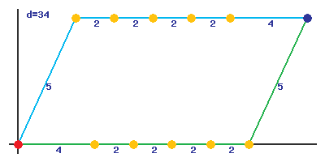

Ο Εύριπος, το δελφίνι της Χαλκίδας, αφού διέδωσε το Χαλκιδικό[^1] αλφάβητο, στην κεντρική Μεσόγειο, αποφάσισε να διακινεί περγαμηνές με το συγκεκριμένο αλφάβητο, στις πολλές παράκτιες πόλεις της Εύβοιας. Η δουλειά του ήταν να παραδίδει γράμματα σε $$N$$ λιμάνια που βρίσκονται σε συντεταγμένες $$(X_i, Y_i)$$. Ξεκινάει λοιπόν το πρωί από το “σπίτι του” στη θέση $$(0, 0)$$ και πάει στο “γραφείο του” στη θέση $$(A, B)$$. Το απόγευμα γυρνάει πάλι στο σπίτι του. Ο Εύριπος μπορεί να παραδώσει μόνο κάποια από τα γράμματα καθώς πηγαίνει στη δουλεία του και τα υπόλοιπα καθώς επιστρέφει. Λόγω όμως της παλίρροιας της Χαλκίδας, την πρώτη φορά είναι αναγκασμένος να πηγαίνει μόνο σε σημεία με μεγαλύτερο $$x$$ από αυτό που ήταν πριν και όταν επιστρέφει, λόγω της αλλαγής του ρεύματος είναι αναγκασμένος να πηγαίνει μόνο σε σημεία με μικρότερο $$x$$ από αυτό που ήταν πριν.[^2]

[^1]: Οι Έλληνες κάτοικοι της Κύμης (περιοχή της Εύβοιας) το μετέφεραν στην ομώνυμη αποικία τους, Κύμη που ίδρυσαν το 754 π.Χ. στην Κάτω Ιταλία. Από αυτούς διαδόθηκε σε όλη την Ιταλία. Το αλφάβητό τους, επί Ρωμαϊκής αυτοκρατορίας καθιερώθηκε σε όλο το δυτικό κόσμος ως Ρωμαϊκό. Το Χαλκιδικό αλφάβητο περιείχε 7 γράμματα του λεγομένου πλέον λατινικού αλφαβήτου: C, D, F (δίγαμμα), L, P, R, και S!!! Τα αρχαιολογικά ευρήματα επιβεβαιώνουν παντοιοτρόπως ότι το ιδιότυπο «χαλκιδικό» αλφάβητο, στο οποίο το Σ γραφόταν ως C, το Δ ως D, το Ξ ως Χ, το Ρ ως R και το Υ ως U είναι το λατινικό (ετρουσκικό) αλφάβητο.

[^2]: Εικόνα: Το «Κύπελλο του Νέστορα» είναι ένα αγγείο από τη Ρόδο. Βρέθηκε σε τάφο της νεκρόπολης της Πιθηκούσας. Δισκοπότηρο που έχει πάνω του χαραγμένο το Ευβοϊκό (Χαλκιδικό) Αλφάβητο!

## Πρόβλημα

Να αναπτύξετε ένα πρόγραμμα σε μια από τις γλώσσες του ΙΟΙ το οποίο, αφού διαβάσει τα δεδομένα, (συντεταγμένες λιμένων), θα βρίσκει ποια είναι η μικρότερη απόσταση που πρέπει να διανύσει ο Εύριπος έτσι ώστε να παραδώσει όλα τα γράμματα.

Ένα παράδειγμα διαδρομής του Εύριπου δίνεται στο παρακάτω σχήμα:

(Σπίτι:0,0, Γραφείο: 15, 4, Λιμάνι, Πρωινή Διαδρομή Απογευματινή Διαδρομή)

## Αρχεία εισόδου

Τα αρχεία εισόδου με το όνομα **evripos.in** είναι αρχεία κειμένου με την εξής δομή: Στην πρώτη γραμμή περιέχουν έναν αριθμό $$N$$ ($$5 \leq N \leq 200$$), τον αριθμό των λιμανιών που πρέπει να επισκεφτεί. Στη δεύτερη γραμμή, υπάρχουν οι συντεταγμένες $$A$$, $$B$$ του “γραφείου” του Εύριπου ($$1 \leq A, B \leq 1.000$$). Στις επόμενες $$N$$ γραμμές υπάρχουν οι συντεταγμένες $$X_i$$, $$Y_i$$ ($$1 \leq X_i < A$$ και $$-1.000 \leq Y_i \leq 1.000$$) των λιμανιών που πρέπει να επισκεφτεί. Όλα τα ζεύγη συντεταγμένων χωρίζονται με ένα κενό.

## Αρχεία εξόδου

Τα αρχεία εξόδου με το όνομα **evripos.out** είναι αρχεία κειμένου με την εξής δομή: Έχουν μία μόνο γραμμή που περιέχει έναν μόνο αριθμό. Τον πλησιέστερο ακέραιο, στην ελάχιστη απόσταση που πρέπει να διανύσει ο Εύριπος ώστε να μοιράσει όλα τα γράμματα.

## Παραδείγματα αρχείων εισόδου - εξόδου

**1o**

| **evripos.in**                         | **evripos.out** |
| ------------------------------------ | ------------- |
| 10 15 4 3 4 4 0 5 4 6 0 7 4 8 0 9 4 10 0 11 4 12 0 |34|
{:.table_with_monospace_font}

**2o**

| **evripos.in**                         | **evripos.out** |
| ------------------------------------ | ------------- |
| 5 6 5 1 1 2 3 3 2 4 4 5 3| 16 |
{:.table_with_monospace_font}

## Παρατηρήσεις
 -  Απόσταση δύο σημείων στον δισδιάστατο χώρο d=((Χ2-Χ1)^2+(Υ2-Υ1)^2)^1/2
 - $$0 < X_i < A$$.
 - Όλα τα σημεία έχουν διαφορετικά $$X_i$$.
 - Υπάρχουν τρεις τουλάχιστον αλγοριθμικές επιλύσεις του παραπάνω προβλήματος με πολυπλοκότητα $$O(N!)$$, $$O(2^N)$$ και $$O(N^3)$$. Λόγω των χρονικών περιορισμών στην επίλυση του προβλήματος η πρώτη λύση θα βαθμολογηθεί με το 50% της βαθμολογίας, η δεύτερη με 70% - 80% και η τρίτη με το 100% εφόσον δώσουν σωστά αποτελέσματα για τα ανάλογα αρχεία εισόδου.
 - Στο link [http://hellenico.gr/evripos](http://hellenico.gr/evripos) θα βρείτε ένα γραφικό περιβάλλον δοκιμής διαδρομών.

