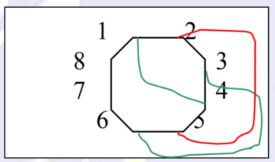

Φοιτητές του τμήματος Μηχανικών Η/Υ και Πληροφορικής του Πανεπιστημίου Πατρών, στα πλαίσια της διπλωματικής τους, προσπαθούν να σχεδιάσουν έναν επεξεργαστή χαμηλού κόστους ο οποίος μπορεί να χτιστεί σε μια βάση κυκλωμάτων, χρησιμοποιώντας κάποια δεδομένα ψηφιακά κυκλώματα.

Τα κυκλώματα απαιτείται να συνδεθούν μεταξύ τους με καλωδιακές συνδέσεις. Οι συνδέσεις δεν πρέπει να διασταυρώνονται με τα κυκλώματα ή με άλλες συνδέσεις, αλλά δεν είναι αναγκαίο να ακολουθήσουν ευθείες γραμμές.

Οι φοιτητές έχουν ήδη κάνει τη βασική σχεδίαση, στην οποία όλα τα εξαρτήματα είναι συνδεδεμένα μεταξύ τους σε ένα βρόχο, τον οποίο καλούμε κύριο βρόχο. (Αυτές οι συνδέσεις είναι το $$1$$ με το $$2$$, το $$2$$ με το $$3$$, …, το $$N$$ με το $$1$$). Τα κυκλώματα στον κύριο βρόχο είναι διαδοχικά αριθμημένα.

Για να αυξηθεί η ταχύτητα του επεξεργαστή, απαιτείται να συνδεθούν απ’ ευθείας κάποια από τα ζευγάρια των εξαρτημάτων. Για κάθε εξάρτημα θα ήταν επιθυμητό να προστεθεί το πολύ μία επιπλέον σύνδεση. Οι φοιτητές έχουν φτιάξει μια λίστα με όλες τις συνδέσεις που θέλουν να προσθέσουν και τις έχουν ταξινομήσει με βάση τη σειρά προτεραιότητάς τους (σημασία τους). Θα προσθέσουν τις $$K$$ πιο σημαντικές από αυτές τις συνδέσεις, όπου το $$K$$ πρέπει να είναι όσο πιο μεγάλο γίνεται χωρίς να επιβάλλει διασταυρώσεις καλωδίων.

## Πρόβλημα

Να αναπτύξετε ένα πρόγραμμα σε μία από τις γλώσσες του ΙΟΙ το οποίο θα προσδιορίσει τη μέγιστη δυνατή τιμή του $$K$$.

## Αρχεία εισόδου

Τα αρχεία εισόδου με όνομα **cpu.in** είναι αρχεία κειμένου με την εξής δομή: Η πρώτη γραμμή του αρχείου περιέχει ένα ακέραιο $$N$$ (όπου $$1 \leq N \leq 200.000$$) ο οποίος εκφράζει τον αριθμό των εξαρτημάτων που ήδη οι φοιτητές έχουν στον κύριο βρόχο. Η δεύτερη γραμμή περιέχει έναν ακέραιο $$M$$ (όπου $$1 \leq M \leq 50.000$$), ο οποίος εκφράζει τον αριθμό των επιπλέον συνδέσεων τις οποίες οι φοιτητές σκοπεύουν να προσθέσουν. Οι υπόλοιπες $$M$$ γραμμές περιέχουν δύο θετικούς ακέραιους $$P$$ και $$Q$$, που δείχνουν ότι οι φοιτητές θέλουν να συνδέσουν το εξάρτημα $$P$$ με το εξάρτημα $$Q$$.

**Προσοχή:**s Δεν υπάρχει καμία σύνδεση ενός εξαρτήματος με τον εαυτό του, κάθε εξάρτημα μπορεί να είναι συνδεδεμένο με ένα γειτονικό εξάρτημα στον κύριο βρόχο. Οι συνδέσεις είναι καταγεγραμμένες με φθίνουσα σειρά σημαντικότητας.

## Αρχεία εξόδου

Τα αρχεία εξόδου με όνομα cpu.out είναι αρχεία κειμένου με την εξής δομή: Έχει ακριβώς μία γραμμή που θα περιέχει έναν απλό ακέραιο, τη μέγιστη δυνατή τιμή του $$K$$.

## Παραδείγματα αρχείων εισόδου - εξόδου

**1o**

| **cpu.in**                         | **cpu.out** |
| ------------------------------------ | ------------- |
| 8 4 1 4 3 6 2 5 7 8 |2|
{:.table_with_monospace_font}

*Εξήγηση:* προστίθενται οι συνδέσεις 1-4 και 3-6. Μετά, η σύνδεση 2-5 επιβάλλει διασταύρωση και άρα δεν μπορεί να προστεθεί.

## Παρατηρήσεις
 - **Μορφοποίηση:** Στην έξοδο, όλες οι γραμμές τερματίζουν με ένα χαρακτήρα newline.
 - **Μέγιστος χρόνος εκτέλεσης:** 5 sec.

