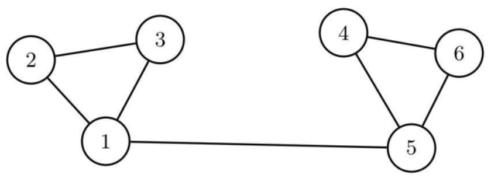

Σήμερα ο Τάκης έχει λίγους πελάτες στην πιτσαρία, οπότε αποφάσισε
να τεστάρει τις γνώσεις σας στην Θεωρία Γραφημάτων, για να περάσει
την ώρα του. Για αυτό, σας ζητάει να κατασκευάσετε έναν απλό,
συνδεδεμένο γράφο, $$N$$ κορυφών, που να περιέχει ακριβώς $$K$$ κομβικά
σημεία και ακριβώς $$L$$ γέφυρες, χρησιμοποιώντας το πολύ $$3N$$ ακμές, ή
να αποφανθείτε ότι αυτό δε γίνεται.

Ένας γράφος λέγεται απλός όταν είναι μη κατευθυνόμενος, δεν έχει
ακμή που να ενώνει μία κορυφή με τον εαυτό της και έχει το πολύ μία
ακμή μεταξύ οποιονδήποτε δύο κορυφών. Επίσης, λέγεται
συνδεδεμένος όταν υπάρχει μονοπάτι (οσωνδήποτε ακμών) μεταξύ
οποιονδήποτε δύο κορυφών του.

Μία κορυφή ενός απλού, συνδεδεμένου γράφου λέγεται κομβικό
σημείο, αν μετά την αφαίρεση αυτής και των ακμών των οποίων
αποτελεί άκρο, ο γράφος που προκύπτει δεν είναι συνδεδεμένος. Μία
ακμή ενός απλού, συνδεδεμένου γράφου λέγεται γέφυρα, αν μετά την
αφαίρεση της, ο γράφος που προκύπτει δεν είναι συνδεδεμένος.

## Δεδομένα εισόδου (stdin)

Η πρώτη γραμμή περιέχει τρεις ακέραιους αριθμούς $$N$$, $$K$$, $$L$$: το
επιθυμητό πλήθος κορυφών, κομβικών σημείων και γεφυρών,
αντίστοιχα.

### Δεδομένα εξόδου (stdout)

Αν δεν υπάρχει τρόπος να κατασκευαστεί γράφος που να ικανοποιεί
όλα τα ζητούμενα, η έξοδος πρέπει να περιέχει μία μόνο γραμμή με
τον αριθμό $$−1$$.

Διαφορετικά, η πρώτη γραμμή πρέπει να περιέχει έναν ακέραιο
αριθμό: το πλήθος των ακμών του γραφού, έστω $$M$$. Στη συνέχεια,
πρέπει να ακολουθούν $$M$$ γραμμές, καθεμία από τις οποίες να περιέχει
δύο αριθμούς: τα άκρα της αντίστοιχης ακμής. Οι κορυφές πρέπει να
είναι αριθμημένες από το $$1$$ έως και το $$N$$. Επιτρέπεται να εκτυπώσετε
οποιαδήποτε έγκυρη κατασκευή.

### Παράδειγμα εισόδου-εξόδου

| **stdin**      | **stdout** |
| :--- | :--- |
| 6 2 1 | 7 1 2 1 3 4 6 5 6 5 4 2 3 5 1 |

**Εξήγηση παραδείγματος:** Σχεδιάζοντας τον γράφο, μπορούμε εύκολα να δούμε ότι είναι
απλός, συνδεδεμένος, αποτελείται από $$6$$ κόμβους, περιέχει ακριβώς $$2$$
κομβικά σημεία και ακριβώς $$1$$ γέφυρα και δεν ξεπερνάει το όριο ακμών.

### Περιορισμοί

 - $$2 \leq N \leq 100.000$$.
 - $$0 \leq K \leq 100.000$$.
 - $$0 \leq L \leq 100.000$$.
 
### Υποπροβλήματα
1. (11 βαθμοί) $$K = 0$$
2. (14 βαθμοί) $$L = N−1$$
3. (21 βαθμοί) $$K \leq L−1$$
4. (23 βαθμοί) $$L = 0$$
5. (31 βαθμοί) Δεν υπάρχουν περαιτέρω περιορισμοί

## Παρατηρήσεις

**Μέγιστος χρόνος εκτέλεσης**: $$1$$ sec. 
**Μέγιστη διαθέσιμη μνήμη**: $$64$$ MB.

